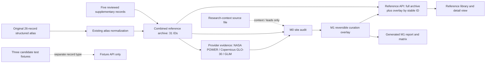

# M1 curation data lineage

The original atlas remains the source of the 26 legacy IDs and claims. Existing normalization creates `data/processed/known-sites.json`; five supplementary records are kept in `data/processed/supplementary-known-sites.json`; the existing build pipeline combines them into `data/processed/reference-sites.json`. Three fixture points stay in `data/processed/candidate-points.json` and are not included in the reference curation manifest.

Provider retrieval artifacts are linked by site ID and stored separately under the existing raw/processed data paths. M0 traced 8 IDs with stored evidence for all three providers: GKC, GKB, WDE, KHA, RTI, DALL, DAL, and AHS-GH. M1 did not retrieve or regenerate provider data.

`data/curation/reference-curation-v1.json` is a separate overlay keyed by `stableId`. It neither edits nor replaces the archive. `scripts/app-api.mjs` loads the overlay alongside the archive and adds `curation` to both reference list and detail responses. Existing API fields remain. The React reference library uses the curation decision badge; the reference detail view shows the rationale and point-sampling restriction. The rendered M1 matrix/report derive from the manifest.
