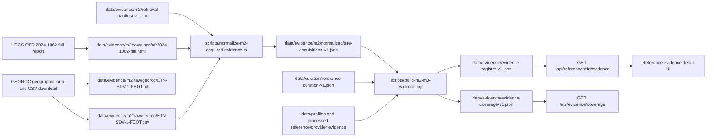

# Updated M2 Data Lineage

The raw HTML and CSV are preserved as separate downloaded payloads. Normalization extracts report-table rows and preserves GEOROC raw row fields, units, broad coordinate bounds, source IDs (or explicitly absent source unique IDs), sample labels, methods, source citation, and limitations. The GEOROC result page is also retained as retrieval context. No raw response is rewritten by the builder.

There are 199 supplemental rows: 195 for MET and 4 for ETN. The MET rows point to the study area by report/site identity, but carry null sample coordinates and `pointComparisonEligible:false`; their values are not mapped into a current comparison factor. The ETN rows retain null point coordinates, broad source bounds, `spatialRelationship:regional_context`, and state `not_representative`. They attach to the existing mineral-evidence factor only as regional context; factor value remains null for point comparison.

The unified registry adds these rows under `supplementalRecords`; its 589 existing reference-factor rows (31 × 19) remain. The builder also regenerates the 155-row acquisition site/source matrix (31 references × five source routes) and the M2 source coverage summary. The 3 test fixtures remain in the separate fixture file and are not added to reference evidence.
