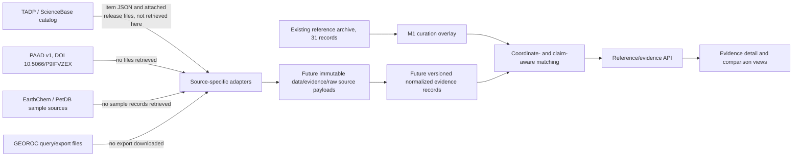

# M2 source lineage

> **Current lineage:** The earlier “zero records” description below reflects the pre-acquisition state. See [`../m2-completion/updated-data-lineage.md`](../m2-completion/updated-data-lineage.md) for the current raw → normalized → unified evidence flow (199 acquired observations, MET and ETN; zero new point-comparison records).

Current new-source lineage terminates at the investigation/adapters: **zero** M2 source payloads and normalized M2 source records exist. `data/evidence/m2-retrieval-coverage-v1.json` records that state. The programmatic PAAD/ScienceBase metadata request was blocked by an anti-bot challenge; it is not represented as a successful empty query. GEOROC remains a documented downloadable/query source rather than a claimed API integration. Existing NASA POWER, Copernicus GLO-30 and GLiM site records remain in their pre-existing raw and processed paths and are inventoried separately by the M3 evidence registry.
