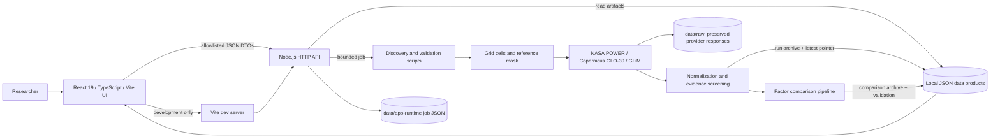

# TerraMatch — Current Project Status and Technical Audit

**Audit date:** 15 November 2026 (Africa/Cairo)  
**Artifact timestamps below:** ISO 8601 UTC, as stored in the artifacts  
**Scope:** Read-only review of the current source tree, data products, reports, test results, and application behavior. No scientific data or existing artifacts were rewritten for this report.

## A. Executive summary

TerraMatch is an independent research prototype for organizing terrestrial evidence that may help researchers study environments relevant to Mars surface missions. It brings together known Earth reference environments, bounded candidate grid cells, mission-specific evidence requirements, provider provenance, and factor-level comparisons. Its purpose is to make evidence coverage and limitations inspectable, not to decide which place is “most Martian.”

The project addresses a practical research problem: candidate environments are often discussed through heterogeneous climate, geological, and terrain descriptions that differ in source, spatial support, period, and confidence. TerraMatch keeps those distinctions visible and separates known references, candidate records, and software fixtures. Its substantive implementation includes 31 reviewed reference records, three provider integrations, four mission profiles, bounded grid generation with conservative reference masking, source-aware comparison, an HTTP API, and a multi-route web application.

The current maturity is a **working, locally runnable research prototype with real historical provider evidence and a functioning artifact-backed UI**. It can demonstrate a four-cell Atacama workflow, existing source evidence for references, the difference between available and missing evidence, and a descriptive candidate/reference matrix. The latest artifact head is a later geological-surface-exploration run: three unmasked cells have climate and GLiM results, while their Copernicus requests failed. The result is not a scientific discovery. It has no validated similarity method, independent benchmark, or suitability conclusion.

This audit also found an artifact lifecycle issue: the current M07 head is newer than the stored top-level discovery validation report. The latest M07 passes the code’s in-memory structural validator, but the persisted report does not validate that head. The API integration test therefore fails on the stale report state. This must be corrected before describing the current latest discovery as persisted-report-validated.

## B. Project architecture

### Runtime architecture

The browser is a React/TypeScript single-page application. In development, Vite serves the web source and proxies `/api` requests to a local Node HTTP service. In production-style local use, the Node service serves the built `web-dist` application as well as API responses. The React client reads allowlisted JSON DTO endpoints; the browser does not read project files directly. Scientific calculations and provider access run in the TypeScript backend/scripts, not in React.

The API reads local JSON products and starts bounded child-process workflows for discovery and comparison. Job and polling state is stored as local JSON under `data/app-runtime/`; scientific outputs are stored separately under `data/processed/`. There is no database or authentication layer. The API binds to loopback by default, applies input/ID/area allowlists and request limits, and only permits configured mission and study-area identifiers.



### Data and artifact lifecycle

- `data/atlas/` is referenced by the source layout, while the supplied original atlas currently resides at the repository root as `أطلس المواقع المشابهة للمريخ (JSON).json`. The research context file is `Mars_Analogues_Haneen_Ayman.json`.
- `data/raw/` stores provider response bodies and raw source-specific records; `data/cache/` stores reusable NASA POWER request responses. These are ignored by Git.
- `data/processed/` contains normalized reference/source products, reports, and run outputs. Unique run JSON files are retained beside `latest.json` pointers.
- Discovery has a top-level `validation-report.json` plus a `validation-reports/<runId>.json` archive directory. A report must match the head run ID to establish persisted validation of that head.
- Comparison has `latest.json`, run archives, and a single `validation-report.json`. Its current report matches its current comparison head.
- `data/app-runtime/` contains local job and per-job output records. It is also ignored by Git and is not a durable deployment store.
- `src/data-sources/` implements provider adapters; `src/normalization/`, `src/discovery/`, `src/comparison/`, and `src/validation/` implement source normalization, bounded search, comparison, and data checks.
- `scripts/` provides retrieval, rebuild, execution, and validation entry points. `web/src/` contains routes, UI components, map, charts, visual scenes, and styling. `tests/` contains Node built-in unit, API, regression, and adapter tests.

### External integrations

1. **NASA POWER Daily Point API** supplies daily gridded climate estimates.
2. **Copernicus DEM GLO-30 public COGs** are read by pixel through `geotiff`; the output is one DSM pixel elevation sample.
3. **GLiM v1.1 ArcGIS Feature Service** supplies generalized point-in-polygon lithology classifications.

The app’s basemap is Esri World Imagery with Natural Earth outlines; it is visual geographic context and is not scientific evidence. The app does not integrate Planetary Computer or Meteomatics. NASA POWER, Copernicus, and GLiM requests have no credentials configured in this prototype. A successful local build does not establish that these live services are reachable.

## C. Scientific data and sources

### Reference records and fixtures

- The supplied atlas contains **26** known-site records. The latest atlas audit (`data/processed/atlas-audit.json`) reports 26 declared/source/valid records, no duplicate IDs, invalid coordinates, or missing coordinates, and 24 approximate coordinates. The atlas has legacy climate and descriptive geology fields, but no formal lithology classification. Its mineral language is not independently verified; the audit flags inferred descriptions for GKC, GKB, WDE, KHA, and GOB. It also records the atlas’s Atacama rainfall discrepancy (7.3 mm/year versus a cited field value below 2 mm/year).
- Five supplements are documented separately in `data/benchmarks/supplementary-site-review.json` and combined into `data/processed/reference-sites.json`: Dallol (DALL), Dalangtan (DAL), Semail Ophiolite (SEM), Gypsum Hill (AHS-GH), and Dasht-e Lut (LUT). Their supporting publications, accepted spatial representation, supported claims, and limitations are recorded in the review. DALL, DAL, and AHS-GH are approximate study-area/pavement/spring-cluster coordinates. SEM and LUT are region-level records with null latitude/longitude; the system does not invent point locations for them.
- The authoritative inventory has **31 `known_analog` records**. `data/processed/candidate-points.json` separately contains **3 `test_fixture` records**. These fixtures are for software tests and are excluded from the reference inventory, map pins, and candidate discovery.

### Provider evidence

| Source | Stored evidence | Meaning and limits |
|---|---|---|
| NASA POWER | Five original atlas sites (GKC, GKB, WDE, KHA, RTI) and three point-area supplements (DALL, DAL, AHS-GH); 2001-01-01 through 2020-12-31; seven parameters; stored raw JSON and normalized daily histories | Gridded/modelled point product, not a field observation. Atlas or study-area coordinates are approximate. Parameters are T2M, T2M_MAX, T2M_MIN, RH2M, PRECTOTCORR, WS10M, and ALLSKY_SFC_SW_DWN. Shortwave radiation is not UV. |
| Copernicus DEM GLO-30 | Five original sites plus three point-area supplements; product `COP-DEM_GLO-30-Public`, Copernicus DEM 2021 release; pixel location, tile, CRS, vertical datum, nominal resolution, and source URL retained | A single DSM pixel in meters, not site mean, bare-earth guarantee, slope, roughness, mobility, or local relief. Buildings/vegetation may affect the DSM. The input point may be approximate. |
| GLiM v1.1 | Five original sites plus three supplementary point-area queries; raw ArcGIS response and separate `xx`, `yy`, `zz` levels retained | Generalized polygon mapping (average scale approximately 1:3.75 million, varying by polygon), not field verification or mineral detection. Multiple intersecting polygons are ambiguous; original values and geometry are preserved. No minerals are inferred from lithology. |

The current stored reference reports show five original-site successes for each source and nine supplementary point-provider successes (three sources × three point-area supplements). Region-level SEM and LUT were correctly skipped by point integrations. Those historical successes must not be conflated with the latest candidate-run outcomes described below.

### Mission profiles and evidence semantics

`data/mission-profiles/mars-surface-v1.json` defines five dimensions, 19 evidence factors, and four missions: rover surface testing, geological surface exploration, extreme environment operations, and drilling/subsurface exploration. Profiles distinguish required, optional, and currently unavailable factors; the selected mission supplies the subset used by discovery screening. In particular, the current M07 head uses `geological_surface_exploration`, requiring mapped lithology, mineral evidence, and geological-process evidence.

The application distinguishes integration availability from a successful result. In stored records, absent observations remain null; provider failures remain failed; multiple GLiM features can remain ambiguous; and unsupported or non-comparable evidence remains unavailable. Temperature range is derived only from valid daily maxima and minima. Precipitation totals are treated as complete only for complete calendar years. Descriptive text, derived values, provider observations, and unavailable evidence are not silently merged.

## D. Completed milestones

“Complete” below means the described software/data deliverable exists and has structural or deterministic test evidence. It does not mean the source claims, factor selection, or analog science have been independently validated.

### M01 — Atlas audit and normalization

- **Objective:** inspect the supplied atlas, preserve it, normalize its records, and separate fixtures.
- **Implemented:** typed location records, runtime schemas, duplicate/coordinate/data checks, an atlas audit, and a 26-reference/3-fixture separation. The benchmark manifest remains planning-only.
- **Key files:** `src/normalization/atlas.ts`, `src/normalization/fixtures.ts`, `src/validation/records.ts`, `scripts/audit-atlas.ts`, `scripts/validate-data.ts`, `tests/atlas.test.ts`.
- **Current evidence:** stored atlas audit reports 26 valid records, zero invalid/duplicate/missing-coordinate records, and 24 approximate coordinates. The deterministic test suite covers atlas count, normalization, fixture separation, null handling, and source-claim caveats.
- **Limits:** legacy atlas climate fields have unknown observation period/coverage and are not promoted to measured NASA POWER data. The source’s mineral and rainfall caveats remain unresolved. The original file was not modified for this report.

### M02 — NASA POWER climate integration

- **Objective:** retrieve and normalize daily climate histories with source periods, units, missingness, and provenance.
- **Implemented:** request construction, response validation/parsing, raw response preservation, caching, daily records, summaries, coverage, and offline rebuild from saved raw responses.
- **Key files:** `src/data-sources/nasa-power/`, `scripts/retrieve-nasa-power.ts`, `scripts/rebuild-nasa-power.ts`, `data/processed/climate/known-sites-daily.json`, `tests/nasa-power.test.ts`.
- **Current stored result:** five original prototype sites have 2001–2020 histories with 100% reported daily coverage for all seven parameters. M06 added the same configured provider coverage for DALL, DAL, and AHS-GH. The retrieval report says its last rebuild used existing raw responses with no network request.
- **Limits:** NASA POWER is gridded and coordinate-dependent; eight selected point/area records do not constitute global coverage or ground truth. Solar radiation is not UV.

### M03 — Copernicus DEM terrain sample

- **Objective:** ingest elevation evidence from Copernicus GLO-30 while retaining raster and coordinate provenance.
- **Implemented:** AWS tile resolution, GeoTIFF metadata and coordinate checks, one-pixel range reads, NoData handling, sample-center metadata, normalization, and validation.
- **Key files:** `src/data-sources/copernicus-dem/`, `scripts/retrieve-copernicus-dem.ts`, `scripts/ingest-copernicus-dem.ts`, `data/processed/terrain/elevation-samples.json`, `tests/copernicus-dem.test.ts`.
- **Current stored result:** validation report records five original site samples; the supplementary report records three more. Raw samples and normalized values remain distinct.
- **Limits:** this is one DSM elevation pixel, not a terrain model or a site mean. The latest candidate terrain calls failed for all three evaluated cells.

### M04 — GLiM geological evidence

- **Objective:** retrieve and preserve generalized mapped lithology without turning it into mineral evidence.
- **Implemented:** validated ArcGIS point queries, raw response retention, normalization of all intersecting polygons and levels, explicit empty/ambiguous/No Data statuses, and offline rebuild.
- **Key files:** `src/data-sources/glim/`, `scripts/retrieve-glim.ts`, `scripts/rebuild-glim.ts`, `data/processed/geology/known-sites-glim.json`, `tests/glim.test.ts`.
- **Current stored result:** five original sites are mapped in the stored geology report; M06 adds three supplementary mapped records. The current latest discovery run also has GLiM successes for each of its three unmasked candidates.
- **Limits:** generalized mapped polygon classes are not ground-truth geology, site-scale mineral detections, or proof that a described geologic process occurred at the candidate point. GLiM’s service metadata does not explicitly establish a separate redistribution license.

### M05 — Mission profiles and benchmark planning

- **Objective:** define versioned mission evidence requirements and a leakage-aware plan for eventual scientific evaluation.
- **Implemented:** four mission profiles, 19 factors in five dimensions, source availability metadata, and a benchmark protocol with explicit fixture separation and no fabricated split.
- **Key files:** `src/schemas/mission-profile.ts`, `data/mission-profiles/mars-surface-v1.json`, `data/benchmarks/blind-benchmark-protocol-v1.json`, `scripts/validate-mission-profiles.ts`, `tests/mission-profile.test.ts`.
- **Current stored result:** the mission validation report is `valid` for profile version 1.0.0, 5 dimensions, 19 factors, 4 missions, 31 references, and 3 fixtures. Benchmark status remains `planning_only`; no split was created or executed.
- **Limits:** factors and requirements are not expert-certified suitability rules. Thirty-one heterogeneous positive references, without independent controls, do not support calibration or a meaningful blind benchmark. The benchmark manifest is not a secure label store.

### M06 — Reference dataset expansion

- **Objective:** expand the original atlas using separately reviewed, cited supplementary records while preserving granularity.
- **Implemented:** five review records with citations and accepted spatial representation, deterministic combined dataset generation, point retrieval for three supplements, and region-level treatment for two.
- **Key files:** `data/benchmarks/supplementary-site-review.json`, `scripts/build-reference-dataset.ts`, `scripts/validate-reference-sites.ts`, `data/processed/reference-sites.json`, `tests/supplementary-evidence.test.ts`.
- **Current stored result:** reference validation reports 26 original + 5 accepted supplements = 31 records; 3 point-eligible and 2 region-level; 9/9 supplementary provider attempts succeeded. Three test fixtures remain separate.
- **Limits:** supplement coordinates identify areas, a pavement, or a spring cluster rather than exact sampling points. Site-specific descriptive literature is not promoted into unverified mineral measurements.

### M07 — Bounded candidate discovery

- **Objective:** create a reproducible bounded grid, mask overlap with point references, retrieve configured evidence, and check required evidence availability.
- **Implemented:** versioned study-area configs, deterministic cell centers and IDs, cell footprint metadata, conservative half-diagonal reference masking, provider result preservation, profile-factor screening, explicit limitations, and validation-before-publish logic in the current API/CLI source.
- **Key files:** `src/discovery/grid.ts`, `src/discovery/point-evidence.ts`, `src/discovery/screen.ts`, `src/discovery/run.ts`, `scripts/run-discovery.ts`, `scripts/validate-discovery.ts`, `tests/discovery.test.ts`.
- **Current head:** see Section E. Its in-memory structural validation returns no errors, but its persisted top-level validation report is stale. Thus the head is **not currently supported by a matching stored M07 validation report**.
- **Limits:** point masking cannot establish geological independence; coordinate-free references are explicitly unmasked. Candidate cell centers are coarse sampling coordinates, not precise field sites. Evidence presence is not analog validity.

### M08 — Candidate/reference comparison

- **Objective:** generate a complete descriptive matrix between discovery candidates and all authoritative references, preserving compatibility and missingness.
- **Implemented:** climate statistics, matching-unit/period checks, exact GLiM-level comparisons, metadata-gated DEM point differences, explicit failed/unavailable/missing/ambiguous states, source paths/provenance, compact seasonal/yearly summaries, and forbidden-score validation.
- **Key files:** `src/comparison/compare.ts`, `scripts/run-comparison.ts`, `scripts/validate-comparison.ts`, `tests/comparison.test.ts`, `tests/report-filter.test.ts`.
- **Current head:** its stored validation report matches its run ID and reports valid. It has 124 candidate/reference pairs and 2,356 factor rows; detailed counts are in Section F.
- **Limits:** descriptive differences do not imply similarity. Some mission profile factors (for example dust/aerosol, UV, pressure, hydrology, and aridity) do not have compatible M08 comparison implementations. Geological-process evidence remains unavailable, including in every current pair.

## E. Candidate discovery

### Workflow

1. The client submits an existing mission ID and configured study-area ID to `POST /api/jobs`.
2. The API checks the request, profile, allowlisted area, request budget, and single-active-job constraint.
3. `generateGrid` creates candidate cell centers from the bounding box and spacing, capped by `maxCandidates`; each candidate stores row, column, spacing, and candidate-cell geometry metadata.
4. `excludeReferenceOverlap` considers valid point-coordinate references and masks a candidate when its nearest point reference is within the configured radius after a conservative cell half-diagonal expansion. Region-level references with no coordinates are listed as unmasked, not assigned guessed points.
5. For unmasked cells, the run attempts configured NASA POWER, Copernicus, and GLiM point integrations. Provider errors are retained. Successful climate data is written to a candidate daily file; a persistence failure is separately recorded.
6. The selected mission’s required factors are joined to evidence statuses. Missing, null, failed, or ambiguous required evidence prevents an evidence-supported-for-review status. Even that status would mean evidence presence only, not suitability.
7. The runner writes a unique run and latest pointer. Validators check identity, schema, grid bounds, masking, candidate/reference/fixture separation, factor status consistency, and pair linkage. The app job records validation stages.

The source code implements bounded limits, including no arbitrary filesystem paths/provider URLs from the browser and a maximum configured grid of 100 cells. The current v2 demonstration config sets a tighter maximum of four cells and a 12-call provider ceiling.

### Current multi-cell configuration and head

Configuration `atacama-climate-transect-v2` is a **bounded demonstration configuration, not a scientific discovery**. It covers latitude -23.6 to -23.2 and longitude -69.6 to -69.2 at 0.2° spacing, producing four cells. It configures a 75 km point-reference exclusion and three point providers (maximum 12 requests before masking).

| Current discovery fact | Stored value |
|---|---|
| Run ID | `ca4250f9-7379-4fc1-af43-d0bd955ed68a` |
| Created | `2026-11-14T22:46:58.967Z` |
| Configuration ID | `b7420de987d454be` |
| Selected mission | `geological_surface_exploration` |
| Configured/generated cells | 4 |
| Masked by point-reference overlap | 1 |
| Evaluated cells | 3 |
| Candidate statuses | 0 evidence-supported-for-review; 3 insufficient evidence; 1 rejected reference overlap |
| Provider outcomes on evaluated cells | NASA POWER 3 successes; GLiM 3 successes; Copernicus 3 failures |

The masked cell was not submitted to providers. Each evaluated candidate has mapped lithology and stored NASA POWER climate; each has a failed Copernicus sample. Under the selected geological-surface profile, required mineral evidence and location-specific geological-process evidence are absent for all three, so all remain insufficient. The profile’s other limitations still apply: GLiM does not prove minerals or point-specific geology, and a failed elevation request is not an elevation value. The study-area rationale describes a climate-oriented Atacama demonstration, while this latest artifact was run using the geological-surface mission; the demo should explicitly select the intended profile before presentation.

### Validation state and lifecycle discrepancy

The current head has a matching archived discovery JSON. The pure `validateDiscoveryRun` and `validateStudyArea` functions returned no errors when applied read-only during this audit. However, the stored `data/processed/discovery-runs/validation-report.json` names run `ad576195-5909-4d11-8a49-34e13e188d3d`, generated at `2026-11-14T22:36:20.162Z`; the only file in `validation-reports/` also names that older run. There is no persisted discovery validation report for current head `ca4250f9-7379-4fc1-af43-d0bd955ed68a`.

The local runtime job `e774340f-f3f4-4001-9cba-214564a4f813` is marked completed and its logs link the current M07 and M08 IDs, but it uses an older, shorter stage schema and has no embedded per-run validation result. The current source `scripts/app-api.mjs` expects a matching validation report before publishing a run. The root cause of the discrepancy was not resolved in this documentation-only task. Do not present the latest M07 as fully persisted-report-validated until this is reconciled.

## F. Candidate-to-reference comparison

### Pair construction and comparison rules

`scripts/run-comparison.ts` reads a discovery artifact, the authoritative 31-reference dataset, and saved normalized evidence; it does not retrieve providers. It emits one pair per candidate-region/reference combination, retains region-level references with null coordinates, identifies both records’ sources, and carries mission evidence separately from the pair’s descriptive comparison. The validator checks the complete Cartesian pair count, exact reference IDs, fixture separation, source/provenance structure, and disallowed score/rank output.

The current matrix contains **4 candidates × 31 references = 124 pairs**, each with 19 factor rows, or **2,356 factor records**. Status totals are:

| Factor state | Records |
|---|---:|
| Compared | 232 |
| Ambiguous | 0 |
| Failed | 93 |
| Unavailable | 2,031 |
| Missing | 0 |

The **232 compared** factors comprise 24 comparisons for each of eight climate factors (seven NASA POWER parameters plus derived daily temperature range), 24 GLiM `xx` comparisons, and 16 GLiM `yy` comparisons. All **93 failed** rows are elevation point comparisons for the three evaluated candidates against 31 references. One masked candidate contributes 31 unavailable elevation rows. The remaining unavailable factors reflect unsupported evidence, absent compatible reference data, placeholder/no-data GLiM levels, or the lack of location-specific mineral/geological-process evidence. Geological-process evidence appears in all 124 pairs and is unavailable in all 124.

### Methods and limits

- **Climate:** both daily histories must be from NASA POWER with matching observation periods and matching parameter units. The output gives candidate-minus-reference differences at q25, median, and q75, with valid/missing counts, coverage, source period, path, and provenance. If both histories are absent but compatible summaries exist, a separately labeled period-mean difference is allowed. Nulls are never imputed as zero. Daily temperature range is derived from valid `T2M_MAX - T2M_MIN` values.
- **Temporal summaries:** when matching daily histories exist, climate factors include hemisphere-labeled three-month calendar-season and calendar-year means with expected, valid, and missing counts and coverage. These summaries are compact and do not copy daily histories into every pair. Seasons are descriptive calendar groups, not mission-specific climate seasons. The current candidate histories allow comparisons with eight retrieved reference histories; summaries do not establish analog suitability.
- **Geology:** GLiM classes are compared only at the same level (`xx`, `yy`, `zz`) and as exact source codes. Multiple polygons remain ambiguous. Placeholder `__` and No Data are not counted as a matched lithology. No mineral result is inferred.
- **Elevation:** a point difference in meters is allowed only with compatible GLO-30 product, nominal resolution, horizontal CRS, and vertical reference metadata. It is not called terrain similarity. Current candidate DEM failures remain failed rows without values.
- **Status meanings:** `failed` is a provider/processing failure; `unavailable` is unsupported or not comparable evidence; `missing` is an explicit missing evidence state; `ambiguous` means evidence cannot be reduced to one supported interpretation; `compared` is a source-compatible descriptive comparison.

The matrix does not calculate overall similarity, weights, ranks, confidence, or mission suitability. There is no scientifically selected normalization or weighting method, independent control set, or calibrated benchmark. A numerical score would overstate what the 31 heterogeneous, mostly positive references and uneven provider coverage can support.

## G. Frontend and user experience

The current application routes are defined in `web/src/App.tsx` and the lazily loaded workspaces in `web/src/Workspace.tsx`:

| Route | Current function |
|---|---|
| `/` | Mission landing page with Earth/Mars scene, inventory counts, sources, workflow links, and scope caveat. The scene is locally generated and can fall back to CSS planets. |
| `/explore` | Map workspace with known reference pins, candidate sampling centers and configured cell polygons, layer/search controls, selected-record inspector, source states, and latest M07/M08 summary. Region-only references are not pinned. |
| `/references` | Searchable, sortable, country/evidence/spatial-granularity filters, paginated table for the authoritative known-reference inventory. |
| `/references/:id` | Reference detail with spatial support, climate/geology/elevation evidence, provenance, and limitations. |
| `/discover` | Mission and configured area selectors, factor-by-factor readiness, explicit unsupported factors, and an API-backed bounded job workflow with status polling. Starting a run makes provider requests. |
| `/candidate/:id` | Stored candidate evidence, climate history/chart when present, source statuses, provenance, and limitations. |
| `/runs` and `/runs/discovery/:id` | App-local run archive list and discovery record inspection. |
| `/comparison` | Candidate/reference matrix with candidate, reference, dimension, factor, and evidence-state filters; expandable factor details and pagination. |
| `/methodology` | M01–M08, source descriptions, factors, and interpretation limits. |
| `/report/:runId` | Print stylesheet/report for the selected comparison record(s), with candidate/reference filters carried into the report and browser Print / Save as PDF. No server-side PDF generator. |

The header includes a persisted dark/light theme. Workspace navigation, map, and comparison routes are lazy-loaded. Styling includes reduced-motion handling, small-screen/constrained-device fallbacks for the 3D scene, and responsive table/workspace layout. The reference API provides curated English country labels and recursively removes Arabic-only display strings without modifying source records. No formal accessibility conformance audit is present; ARIA labels and semantic controls exist but are not a WCAG certification.

The interaction and API integration are implemented, but current artifact validation health limits what the landing/dashboard can honestly communicate. The latest job may be marked completed while the API summary reports its discovery validation as stale. Browser E2E is not established by this report; see Section H.

## H. Testing, validation, and build status

### Checks run for this report

- Backend TypeScript **no-emit** check: passed.
- Frontend TypeScript **no-emit** check: passed.
- Existing Node test files were run without rebuilding `dist`: **54 passed, 1 failed (55 total)**. The failure is `app API exposes validated project artifacts and rejects unsafe inputs` at `tests/app-api.test.mjs:23`: expected `latestDiscoveryValidation.status === "valid"`, received `"stale"`. This is caused by the stored M07 validation report naming an older run.
- Read-only in-memory validator check: current M07 structural/study-area validators returned no errors; current M08 validator returned no errors; reference records, fixture records, mission profile, and discovery/comparison linkage checks returned no errors. This did not write a new report and does not replace the missing current-run M07 report.
- Stored M06 reference report: valid, 26 original + 5 supplements = 31; fixtures 3 separate; supplementary provider attempts 9/9 success.
- Stored M05 profile report: valid, 5 dimensions, 19 factors, 4 missions, reference count 31, fixture count 3; benchmark remains planning-only.
- Stored M08 comparison report: valid, and its run ID matches the comparison head.
- Stored NASA POWER, terrain, and geology validation reports record 5/5 original-site results for their respective providers. The supplementary retrieval report records 9/9 success.
- **Production build:** a successful build was recorded in the preceding project verification, with large MapLibre GL and React Three Fiber chunks. It was not rerun in this audit because the requested scope is documentation-only and a build rewrites existing build output. Treat the no-emit checks above as the fresh compile evidence for this report.

### Browser and accessibility status

There is no checked-in E2E harness or `test:e2e` script. A prior manual browser smoke check observed landing, Explore map/cells, mission readiness and area controls, comparison, filtered report, region-level reference filter, and dark/light theme toggling. It did not execute a discovery job, test map panning/zoom, or establish automated browser coverage. Do not report browser E2E as passing. No formal screen-reader, keyboard-only, contrast, or WCAG accessibility audit was located.

### Known repository hygiene item

The current tree contains `data/processed/mission-profiles/validation-report.24292.tmp`, a leftover temporary file from an earlier report-write failure. It was not removed because this task must not alter existing artifacts. It is not a validation report and should be handled separately during a controlled cleanup.

## I. Current limitations and risks

### 1. Scientific and data limitations

- Atlas coordinates are mostly approximate; supplementary coordinates represent named areas or clusters. Grid centers are not exact field sites.
- NASA POWER is gridded/modelled, not field data; eight reference records with histories are not comprehensive coverage.
- GLO-30 is a single DSM pixel, not terrain characterization. Latest candidate terrain requests failed.
- GLiM is generalized mapped lithology, not mineralogy or site-level geological verification. Geological-process and mineral evidence are not established for the candidates.
- Hydrology, aridity/water balance, UV, dust/aerosol, quantitative sediment/regolith, terrain derivatives, and subsurface properties are missing or unsupported.
- Earth cannot reproduce Mars gravity, atmosphere, radiation, or environmental conditions. No validated mission-suitability or analog score exists.
- The benchmark is not run. The dataset has no defensible train/holdout split or independent negative/control examples.

### 2. External provider and reliability limitations

- Provider availability is environment-dependent. In the latest head, three of three Copernicus requests failed; three of three NASA POWER and GLiM requests succeeded. A previous head had different provider outcomes, demonstrating why reports must quote the run they describe.
- Provider success does not guarantee meaningful local representation; source spatial support and coordinate uncertainty remain limiting.
- NASA POWER, Copernicus, and GLiM are remote public services; rate limits, downtime, access policy, dataset revisions, or network controls may change behavior.
- GLiM redistribution/licensing needs review before republishing source attributes or polygons.

### 3. Backend and artifact lifecycle limitations

- **Current M07 persisted validation report is stale.** Latest run `ca4250f9-7379-4fc1-af43-d0bd955ed68a` is not the report’s run `ad576195-5909-4d11-8a49-34e13e188d3d`. The API integration test fails as a result. Current M07 in-memory structural validation passes, but persistently validated status is not evidenced.
- Latest M08 report is valid and links to the current M07 run. The API currently reports `stale` for discovery validation even though M08’s pair linkage is valid.
- App jobs, archives, latest pointers, and validator reports are local JSON files without transactional database guarantees. The current job file’s legacy schema/log does not retain per-run validator outcomes.
- No database, authentication, multi-user concurrency model, or guaranteed hosting persistence is implemented. The API is intended for local use and binds to loopback.
- The orphan `.tmp` file indicates one prior atomic report replacement failure remains in the workspace.

### 4. Frontend and UX limitations

- The configured study area’s rationale is climate-oriented, while the latest artifact was created for geological surface exploration. The demo should deliberately select and verify the intended mission before presenting it.
- Candidate status remains insufficient for required missing evidence; display should not imply scientific screening success.
- Remote imagery is context only and may be unavailable without affecting scientific data.
- The report uses browser print-to-PDF and depends on browser print behavior.
- No formal accessibility audit has been performed.

### 5. Testing and deployment limitations

- Automated browser E2E is absent. A manual smoke test is not equivalent.
- One current automated API integration test fails on stale M07 validation state (54/55 pass in the read-only test run).
- The production build was not rerun during this report audit; the previous successful result includes chunk-size warnings.
- No public deployment, authentication, database durability, monitoring, or operational incident handling is verified.
- Successful adapter unit tests validate code paths and mocks; they do not prove live integrations currently work.

## J. Recommended next steps

### Before a public presentation or submission

1. **Reconcile M07 validation publication.** Ensure a report for `ca4250f9-7379-4fc1-af43-d0bd955ed68a` is generated by the correct pipeline and atomically published with its matching run. Verify that the API summary changes from stale to valid and rerun the API integration test. Preserve the existing run and source outcomes; do not edit them by hand.
2. **Confirm the intended demo mission.** The UI defaults to `extreme_environment_operations`, but the latest run is `geological_surface_exploration`. Decide which profile to present, run a bounded deterministic or available-provider workflow through the app, and verify all three IDs: discovery, discovery validation, and comparison.
3. **Re-run the complete test/build set after the lifecycle correction.** Include `npm.cmd test`, `npm.cmd run build:app`, reference/profile validation, and the matching discovery/comparison validators. Capture a real E2E result only if a harness is added and run successfully.
4. **Demonstrate provider state truthfully.** The latest run has NASA POWER and GLiM success on three cells, Copernicus failure on three, one masked cell, and missing required mineral/process evidence. Have a no-network fallback walkthrough using archived verified provider data, clearly labeled historical, if the live network is unreliable.

### Important improvements for a stronger research submission

5. Add a maintained browser E2E harness around deterministic seeded API/artifacts, with journeys for readiness, selectors, candidate geometry/details, comparison filters, report filters, theme, and map interaction.
6. Add runtime provider health/retry reporting and per-job validation fields, and make stale artifact-head state visually prominent. Keep live retrieval outcomes separate from historical successes.
7. Complete an expert review of mission factors, evidence suitability, coordinate uncertainty, and use of each source. Improve provenance citations and GLiM reuse/license review before distribution.
8. Add keyboard, screen-reader, contrast, and responsive accessibility checks; distinguish map interaction tests from map rendering checks.

### Future scientific validation and operational readiness

9. Obtain mission-specific, independently reviewed positive references and negative/control examples; pre-register spatial grouping, coordinate uncertainty, sample size, metrics, and label custody before any benchmark split.
10. Only after scientific review, consider a transparent factor normalization/comparison method. Any future score must be calibrated and externally reviewed; do not derive it from the current positive-only atlas.
11. Before deployment beyond localhost, decide authentication, persistence, execution isolation, request quotas, provider terms, monitoring, backups, and artifact retention. None are established by the current prototype.

## K. Reproduction guide

Run from the repository root in PowerShell. The commands below are present in the current `package.json`.

```powershell
# Install locked dependencies
npm.cmd ci

# Deterministic unit, API, and regression tests
npm.cmd test

# Validate original normalized data, known sites, and fixture separation
npm.cmd run validate:data

# Validate combined 31-reference inventory
npm.cmd run validate:reference-sites

# Validate 4 mission profiles and benchmark planning artifact
npm.cmd run validate:mission-profiles

# Run bounded discovery using configured defaults, then validate it
npm.cmd run discover:candidates
npm.cmd run validate:discovery

# Compare the current discovery against 31 references, then validate it
npm.cmd run compare:candidates
npm.cmd run validate:comparison

# Run the development frontend and local API
npm.cmd run dev

# Build backend and frontend for production-style local serving
npm.cmd run build:app
npm.cmd start
```

Development opens at `http://127.0.0.1:5173/`; production-style local serving opens at `http://127.0.0.1:8787/`. `npm.cmd run discover:candidates` makes live external requests and may create a new head with different outcomes. The validation scripts write validation reports. To avoid refreshing provider data, do not run provider commands as part of a UI-only demonstration. `npm.cmd run retrieve:nasa-power`, `npm.cmd run retrieve:copernicus-dem`, `npm.cmd run retrieve:glim`, and `npm.cmd run retrieve:supplementary-evidence` are separate retrieval tasks and are not required to compare already stored evidence.

There is **no E2E command** in the current `package.json`.

## L. Final assessment

TerraMatch can demonstrate a complete evidence-organizing workflow: choose a Mars mission profile, configure a bounded Earth grid, apply conservative point-reference masking, retrieve source evidence, inspect provider and missing-evidence states, compare compatible factors with known references, and create a filtered print report. The 31-reference inventory, three isolated fixtures, versioned profiles, source adapters, API, and interface provide a meaningful technical prototype.

It cannot scientifically claim that a candidate is a confirmed Mars analog, rank locations, estimate confidence, or establish mission suitability. It has no validated scoring method, no expert-validated benchmark, and incomplete mission evidence. Provider success remains selective and geographically coarse.

The web application is suitable for a **carefully narrated local prototype demonstration**, with a clear explanation of the current provider results and evidence gaps. It is not yet in a cleanly verified submission state: the current M07 validation report is stale, the API integration test fails, the latest run selected a different mission from the climate-oriented demo rationale, and automated browser E2E is absent. Resolve those integrity and presentation issues, rerun the full verification suite, and preserve a reproducible, matching artifact head before final submission.
